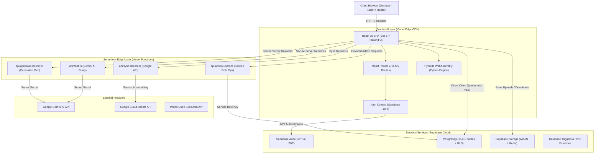

# System Architecture & Technical Specifications

**Platform:** DataCamp Student Club Web Platform (`datacamp-student-club`)  
**Version:** 1.0.0 Production  
**Last Updated:** October 2026  

---

## 1. High-Level Architectural Overview

The platform uses a modern decoupled architecture combining a high-performance **Single Page Application (SPA)** with **Edge/Serverless Functions** and a managed **PostgreSQL Backend as a Service (Supabase)**.

---

## 2. Frontend Layer (Client Application)

### 2.1 Core Frameworks & Tooling
* **React 19:** Utilizing concurrent rendering, optimized hooks, and React 19 state synchronization patterns.
* **TypeScript (~5.8):** Strict type safety throughout components, hooks, services, and types (`src/types/`).
* **Vite 6:** Ultra-fast ES module bundler configured with custom Rollup code splitting and route chunking.
* **Tailwind CSS v4:** Modern utility-first styling with comprehensive RTL/LTR bidirectional support.
* **Framer Motion (`motion`):** Smooth layout animations and micro-interactions.
* **Lucide React:** Standardized icon set across all pages.

### 2.2 Route-Level Code Splitting & Performance
The application uses `React.lazy()` with a branded animated `<RouteLoadingFallback />` to divide pages into modular chunks.

* **Main Entry Chunk:** Kept down to **214 KB** (from 3.2 MB in legacy builds).
* **Vendor Splitting:**
  - `vendor-react`: React, React DOM, React Router v7.
  - `vendor-icons`: Lucide React SVG components.
  - `vendor-supabase`: Supabase Client and authentication logic.
  - `vendor-motion`: Framer Motion animation engine.
  - `vendor-charts`: Recharts analytics visualization.
  - `vendor-exports`: jsPDF, html2canvas, and xlsx document generation.

### 2.3 In-Browser Code Sandboxes
* **Pyodide (WebAssembly Python):** Compiles and executes Python data science code directly inside the student's browser sandbox, requiring zero server round-trips for core lessons.
* **Piston Fallback Engine:** For multi-language code compilation (C++, Java, JavaScript) through server-side containerized APIs.

---

## 3. Serverless Edge Layer (`api/`)

To protect private keys and prevent API abuse, all privileged external integrations operate through Vercel Serverless Functions:

1. **`api/chat.ts`:**
   - Proxies AI queries to `gemini-2.5-flash`.
   - Injects club-specific system prompts (DataCamp Club AI Assistant).
   - Keeps `GEMINI_API_KEY` strictly on the server.
2. **`api/generate-lesson.ts`:**
   - Automatically builds interactive curricula, coding exercises, and automated test cases.
3. **`api/admin-users.ts`:**
   - Handles elevated user administration actions requiring `SUPABASE_SERVICE_ROLE_KEY`.
4. **`api/sync-sheets.ts`:**
   - Synchronizes attendance records and registrations to Google Spreadsheets using Google Service Account credentials.

---

## 4. Backend & Database Layer (Supabase)

### 4.1 Database Architecture (PostgreSQL 15)
The platform schema consists of 13 primary relational tables:
1. `profiles`: Extends `auth.users` with points, ranks, avatar, and roles.
2. `tracks`: Learning pathways (Data Science, Python, AI, Machine Learning).
3. `courses`: Structured learning modules under tracks.
4. `lessons`: Individual lessons with interactive code editor contents.
5. `user_progress`: Tracking completion and scores per student.
6. `events`: Club workshops, webinars, and hackathons.
7. `event_registrations`: Ticket management, check-in flags, and QR verification.
8. `blog_posts`: Club technical articles, tutorials, and announcements.
9. `gallery`: Media album storing club photos and activities.
10. `certificates`: Verifiable graduation and workshop certificates with QR verification.
11. `system_settings`: Platform-wide configuration, social links, and club metadata.
12. `notifications`: In-app alert system for students and staff.
13. `audit_logs`: Administrative actions tracking for security accountability.

### 4.2 Row Level Security (RLS)
Every table is locked down with PostgreSQL RLS:
- **Public Reads:** Permitted for published events, public blog posts, approved gallery photos, and verified certificates.
- **Student Access:** Restricted to viewing and modifying only their own profile and progress.
- **Admin/Staff Access:** Full management access governed by `profiles.role IN ('admin', 'super_admin')`.

---

## 5. Security & Isolation Boundaries

1. **Client Isolation:**
   - No `service_role` keys or private API tokens exist in the client build.
   - Any sensitive operation routes through authenticated serverless endpoints.
2. **Content Security Policy (CSP):**
   - Configured in `vercel.json` to mitigate Cross-Site Scripting (XSS).
   - Disallows unauthorized remote script and frame embedding.
3. **Permissions Policy:**
   - Explicitly limits hardware access:
   - `camera=(self)`: Allowed exclusively for the in-browser QR attendance scanner.
   - `microphone=()` & `geolocation=()`: Blocked completely.
