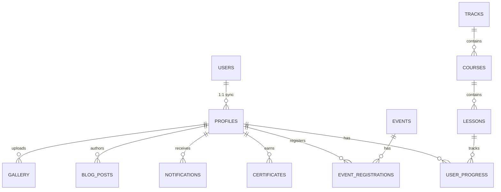

# Database Schema, RLS & Storage Specifications

**Platform:** DataCamp Student Club Platform (`datacamp-student-club`)  
**Database Engine:** PostgreSQL 15+ (Hosted on Supabase)  
**Schema Script:** [`supabase/full_schema.sql`](../supabase/full_schema.sql) (Unified 77.5 KB 1-Click Migration)  

---

## 1. Relational Schema Architecture

The platform uses a relational PostgreSQL schema designed for high integrity, fast indexing, and complete Row Level Security (RLS) governance.



---

## 2. Table Specifications

### 2.1 `profiles`
Extends `auth.users` with student profile details, gamification points, and role designations.
* **Columns:**
  - `id` (`UUID`, PK, references `auth.users(id)` ON DELETE CASCADE)
  - `full_name` (`TEXT`, NOT NULL)
  - `email` (`TEXT`, NOT NULL, UNIQUE)
  - `avatar_url` (`TEXT`)
  - `role` (`TEXT`, DEFAULT `'student'`, CHECK: `student`, `instructor`, `club_leader`, `admin`, `super_admin`)
  - `points` (`INTEGER`, DEFAULT `0`)
  - `level` (`INTEGER`, DEFAULT `1`)
  - `university_id` (`TEXT`)
  - `department` (`TEXT`)
  - `created_at` (`TIMESTAMPTZ`, DEFAULT `NOW()`)
  - `updated_at` (`TIMESTAMPTZ`, DEFAULT `NOW()`)

### 2.2 `tracks`
Top-level learning pathways (e.g. Data Analysis, Machine Learning, Python Basics).
* **Columns:**
  - `id` (`UUID`, PK, DEFAULT `gen_random_uuid()`)
  - `title` (`TEXT`, NOT NULL)
  - `description` (`TEXT`)
  - `icon` (`TEXT`)
  - `order_index` (`INTEGER`, DEFAULT `0`)
  - `is_published` (`BOOLEAN`, DEFAULT `true`)
  - `created_at` (`TIMESTAMPTZ`)

### 2.3 `courses`
Curriculum modules under a learning track.
* **Columns:**
  - `id` (`UUID`, PK, DEFAULT `gen_random_uuid()`)
  - `track_id` (`UUID`, references `tracks(id)` ON DELETE CASCADE)
  - `title` (`TEXT`, NOT NULL)
  - `description` (`TEXT`)
  - `duration_hours` (`NUMERIC`)
  - `difficulty` (`TEXT`, CHECK: `beginner`, `intermediate`, `advanced`)
  - `order_index` (`INTEGER`)
  - `is_published` (`BOOLEAN`, DEFAULT `true`)

### 2.4 `lessons`
Individual practical lessons containing code templates and exercises.
* **Columns:**
  - `id` (`UUID`, PK, DEFAULT `gen_random_uuid()`)
  - `course_id` (`UUID`, references `courses(id)` ON DELETE CASCADE)
  - `title` (`TEXT`, NOT NULL)
  - `content_markdown` (`TEXT`)
  - `starter_code` (`TEXT`)
  - `solution_code` (`TEXT`)
  - `language` (`TEXT`, DEFAULT `'python'`)
  - `points_reward` (`INTEGER`, DEFAULT `10`)
  - `order_index` (`INTEGER`)

### 2.5 `user_progress`
Logs student lesson completion, code submission scores, and completion status.
* **Columns:**
  - `id` (`UUID`, PK, DEFAULT `gen_random_uuid()`)
  - `user_id` (`UUID`, references `profiles(id)` ON DELETE CASCADE)
  - `lesson_id` (`UUID`, references `lessons(id)` ON DELETE CASCADE)
  - `status` (`TEXT`, CHECK: `not_started`, `in_progress`, `completed`)
  - `last_code_submitted` (`TEXT`)
  - `completed_at` (`TIMESTAMPTZ`)
  - UNIQUE(`user_id`, `lesson_id`)

### 2.6 `events`
Club workshops, bootcamps, webinars, and hackathons.
* **Columns:**
  - `id` (`UUID`, PK, DEFAULT `gen_random_uuid()`)
  - `title` (`TEXT`, NOT NULL)
  - `description` (`TEXT`)
  - `event_date` (`TIMESTAMPTZ`, NOT NULL)
  - `location` (`TEXT`)
  - `capacity` (`INTEGER`, DEFAULT `100`)
  - `is_virtual` (`BOOLEAN`, DEFAULT `false`)
  - `meeting_url` (`TEXT`)
  - `status` (`TEXT`, CHECK: `upcoming`, `ongoing`, `completed`, `cancelled`)
  - `cover_image` (`TEXT`)

### 2.7 `event_registrations`
Student event RSVPs, unique ticket tokens, and attendance check-in status.
* **Columns:**
  - `id` (`UUID`, PK, DEFAULT `gen_random_uuid()`)
  - `event_id` (`UUID`, references `events(id)` ON DELETE CASCADE)
  - `user_id` (`UUID`, references `profiles(id)` ON DELETE CASCADE)
  - `ticket_code` (`TEXT`, UNIQUE, NOT NULL)
  - `attended` (`BOOLEAN`, DEFAULT `false`)
  - `checked_in_at` (`TIMESTAMPTZ`)
  - UNIQUE(`event_id`, `user_id`)

### 2.8 `blog_posts`
Articles, technical blogs, and club announcements.
* **Columns:**
  - `id` (`UUID`, PK, DEFAULT `gen_random_uuid()`)
  - `author_id` (`UUID`, references `profiles(id)`)
  - `title` (`TEXT`, NOT NULL)
  - `slug` (`TEXT`, UNIQUE, NOT NULL)
  - `content_markdown` (`TEXT`, NOT NULL)
  - `cover_image` (`TEXT`)
  - `is_published` (`BOOLEAN`, DEFAULT `false`)
  - `published_at` (`TIMESTAMPTZ`)

### 2.9 `gallery`
Club photo album and event memories.
* **Columns:**
  - `id` (`UUID`, PK, DEFAULT `gen_random_uuid()`)
  - `title` (`TEXT`, NOT NULL)
  - `image_url` (`TEXT`, NOT NULL)
  - `category` (`TEXT`)
  - `event_id` (`UUID`, references `events(id)`)
  - `uploaded_by` (`UUID`, references `profiles(id)`)

### 2.10 `certificates`
Verifiable digital certificates with cryptographic serial numbers and QR links.
* **Columns:**
  - `id` (`UUID`, PK, DEFAULT `gen_random_uuid()`)
  - `serial_number` (`TEXT`, UNIQUE, NOT NULL)
  - `user_id` (`UUID`, references `profiles(id)`)
  - `title` (`TEXT`, NOT NULL)
  - `issue_date` (`DATE`, NOT NULL)
  - `pdf_url` (`TEXT`)
  - `metadata` (`JSONB`, DEFAULT `'{}'::jsonb`)

### 2.11 `system_settings`
Global platform configuration key-value storage (social links, contact info).
* **Columns:**
  - `key` (`TEXT`, PK)
  - `value` (`JSONB`, NOT NULL)
  - `updated_at` (`TIMESTAMPTZ`)

### 2.12 `notifications`
Direct in-app alerts for users.
* **Columns:**
  - `id` (`UUID`, PK, DEFAULT `gen_random_uuid()`)
  - `user_id` (`UUID`, references `profiles(id)` ON DELETE CASCADE)
  - `title` (`TEXT`, NOT NULL)
  - `message` (`TEXT`, NOT NULL)
  - `is_read` (`BOOLEAN`, DEFAULT `false`)
  - `created_at` (`TIMESTAMPTZ`, DEFAULT `NOW()`)

### 2.13 `audit_logs`
Administrative actions audit trail.
* **Columns:**
  - `id` (`UUID`, PK, DEFAULT `gen_random_uuid()`)
  - `actor_id` (`UUID`, references `profiles(id)`)
  - `action` (`TEXT`, NOT NULL)
  - `entity_type` (`TEXT`)
  - `entity_id` (`TEXT`)
  - `details` (`JSONB`)
  - `created_at` (`TIMESTAMPTZ`, DEFAULT `NOW()`)

---

## 3. Row Level Security (RLS) Policies

Every single table in the database has RLS explicitly enabled:
`ALTER TABLE table_name ENABLE ROW LEVEL SECURITY;`

### 3.1 Policy Matrix Summary

| Table | Public Access | Authenticated User | Admin / Super Admin |
|---|---|---|---|
| `profiles` | Read basic info | Read own profile, update own profile | Read all, update role and points |
| `tracks` | Read published | Read published | Full CRUD |
| `courses` | Read published | Read published | Full CRUD |
| `lessons` | Read published | Read & execute | Full CRUD |
| `user_progress` | None | Read own progress, insert/update own progress | Read all progress |
| `events` | Read public events | Register for events | Full CRUD & scan tickets |
| `event_registrations` | None | Read own registrations, create own RSVP | Read all, update `attended` |
| `blog_posts` | Read published | Read published | Full CRUD |
| `gallery` | Read public photos | Read public photos | Full CRUD |
| `certificates` | Verify by serial | Read own certificates | Full CRUD & issue certificates |
| `system_settings` | Read public keys | Read public keys | Full CRUD |
| `notifications` | None | Read own, mark own as read | Create platform-wide notifications |
| `audit_logs` | None | None | Read only |

---

## 4. Stored Procedures & Triggers

### 4.1 Automatic Profile Provisioning (`handle_new_user`)
When a user registers via Supabase Auth, a trigger automatically inserts a record into `public.profiles`:
```sql
CREATE OR REPLACE FUNCTION public.handle_new_user()
RETURNS trigger AS $$
BEGIN
  INSERT INTO public.profiles (id, full_name, email, role, points, level)
  VALUES (
    NEW.id,
    COALESCE(NEW.raw_user_meta_data->>'full_name', split_part(NEW.email, '@', 1)),
    NEW.email,
    'student',
    0,
    1
  )
  ON CONFLICT (id) DO NOTHING;
  RETURN NEW;
END;
$$ LANGUAGE plpgsql SECURITY DEFINER;

CREATE TRIGGER on_auth_user_created
  AFTER INSERT ON auth.users
  FOR EACH ROW EXECUTE FUNCTION public.handle_new_user();
```

### 4.2 Super Admin Elevation (`promote_admin_by_email`)
Safe stored procedure for 1-click super admin creation:
```sql
CREATE OR REPLACE FUNCTION public.promote_admin_by_email(target_email text)
RETURNS text AS $$
DECLARE
  v_user_id uuid;
BEGIN
  SELECT id INTO v_user_id FROM public.profiles WHERE email = target_email;
  IF v_user_id IS NULL THEN
    RAISE EXCEPTION 'User with email % does not exist in profiles', target_email;
  END IF;

  UPDATE public.profiles
  SET role = 'super_admin'
  WHERE id = v_user_id;

  RETURN 'Successfully promoted ' || target_email || ' to super_admin';
END;
$$ LANGUAGE plpgsql SECURITY DEFINER;
```

---

## 5. Storage Buckets Configuration

The following public/private buckets are defined in Supabase Storage:
1. `avatars` (Public): User avatar images. Max file size: 2MB.
2. `gallery` (Public): Event photo uploads. Max file size: 10MB.
3. `certificates` (Public): Rendered PDF certificates. Max file size: 5MB.
4. `blog` (Public): Blog post cover and embedded images. Max file size: 5MB.
